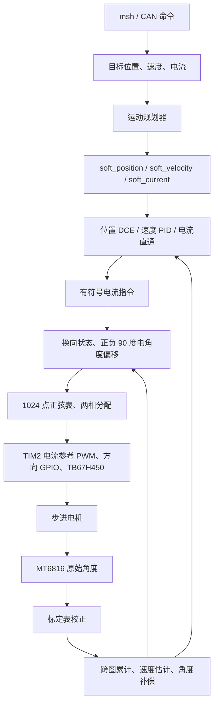

# XDriver 步进电机闭环控制说明

本文依据当前项目代码整理，重点解释 `xdrv pos 1000` 从命令输入到电机保持位置的全过程，以及到位后抖动的可能机制。

本文描述的是当前实现，不代表所有控制策略均已完成实机验证。公式中用近似实数运算解释定点算法；实际行为以代码的运算顺序、整数舍入和限幅为准。本文不修改固件参数或控制逻辑。

## 1. 先明确当前控制架构

本工程使用 MT6816 反馈转子角度，STM32 计算位置或速度控制输出，再通过 TB67H450 的电流参考与方向信号驱动两相步进电机。

需要区分三个概念：

- **机械闭环**：位置、速度由编码器反馈，参与控制计算。
- **电流矢量换相**：依据转子位置生成两相正弦电流参考，并用正负 90° 电角度偏移产生转矩。
- **软件电流环**：当前这条控制链没有读取实际相电流，再进行 Clarke/Park、dq 电流 PI 和逆变换。这里不能套用完整的三环 PMSM FOC 架构。

TB67H450 按参考信号执行硬件电流调节；实际相电流是否准确跟随，需要通过硬件测量确认。`foc_current`、`xdrv status` 的 `current` 和 `xdrv jit` 的 `ispan` 都是软件电流指令，不是实测电流。

位置模式不是“位置 PID 输出速度，再串联速度 PID”。当前是 **DCE 同时使用位置误差与速度误差，直接生成电流指令**。独立的速度 PID 用于速度模式。



## 2. 代码导航

以下链接均相对于本文所在目录。

| 文件 | 责任 |
|---|---|
| [main.c](../../Core/Src/main.c) | RT-Thread main 线程调用 `foc_app_init()` |
| [app_foc.c](../UserApp/app_foc.c) | 配置、初始化、20 kHz 入口、家务线程、msh 诊断与命令 |
| [motor_types.h](../Ctrl/Motor/motor_types.h) | 机械整步、位置单位、模式和状态枚举 |
| [motor.h](../Ctrl/Motor/motor.h) | 电机与控制器数据结构 |
| [motor.c](../Ctrl/Motor/motor.c) | 反馈处理、DCE、速度 PID、模式与状态处理 |
| [motion_planner.h](../Ctrl/Motor/motion_planner.h) | 规划器结构及 20 kHz 周期常量 |
| [motion_planner.c](../Ctrl/Motor/motion_planner.c) | 电流、速度、位置及轨迹规划 |
| [mt6816_base.c](../Ctrl/Sensor/Encoder/mt6816_base.c) | MT6816 数据校验、原始角度及查表校正 |
| [mt6816_stm32.c](../Port/mt6816_stm32.c) | SPI 寄存器访问、超时保护及恢复 |
| [encoder_calibrator_base.c](../Ctrl/Sensor/Encoder/encoder_calibrator_base.c) | 正反向标定采样、检查、表生成和保存 |
| [tb67h450_base.c](../Ctrl/Driver/tb67h450_base.c) | 正弦查表、两相电流参考、方向及休眠制动 |
| [tb67h450_stm32.c](../Port/tb67h450_stm32.c) | TIM2 比较值与 GPIO 输出 |
| [stm32f1xx_it.c](../../Core/Src/stm32f1xx_it.c) | TIM4 中断接入 |
| [interface_can.c](../UserApp/protocols/interface_can.c) | CAN 命令转换与参数修改 |
| [configurations.h](../UserApp/configurations.h) | Flash 配置结构 |

## 3. 机械角、电角度与位置单位

### 3.1 三个核心常量

```c
MOTOR_ONE_CIRCLE_HARD_STEPS = 200;
SOFT_DIVIDE_NUM = 256;
MOTOR_ONE_CIRCLE_SUBDIVIDE_STEPS = 200 * 256;
```

| 常量 | 含义 | 当前值 |
|---|---|---:|
| `MOTOR_ONE_CIRCLE_HARD_STEPS` | 机械一圈的整步数 | 200 |
| `SOFT_DIVIDE_NUM` | 一个整步对应的内部位置单位 | 256 |
| `MOTOR_ONE_CIRCLE_SUBDIVIDE_STEPS` | 机械一圈对应的内部位置单位 | 51200 |

200 整步/圈对应步距角：

$$
\alpha_{\mathrm{step}}=\frac{360^\circ}{200}=1.8^\circ
$$

这里的 count 是软件位置单位，不等于一个编码器原始码，也不保证机械轴能准确定位到一个 count。

### 3.2 为什么一个整步是 256

典型两相混合式步进电机的四个整步对应一个电周期。例如单相通电整步序列为：

```text
A+ -> B+ -> A- -> B- -> A+
```

一个整步是 90° 电角度。工程中一个电周期使用 1024 点正弦表，因此：

$$
N_{\mathrm{count/step}}=1024/4=256
$$

| 范围 | counts | 机械角 | 电角度 |
|---|---:|---:|---:|
| 一个内部位置单位 | 1 | 0.00703125° | 0.3515625° |
| 一个整步 | 256 | 1.8° | 90° |
| 一个电周期 | 1024 | 7.2° | 360° |
| 一个机械圈 | 51200 | 360° | 50 个电周期 |

对于这里的典型 1.8° 两相混合式电机，可以把转子齿结构理解为形成 50 对有效磁极，不应简单理解为安装了 50 对独立磁铁。

理想关系为：

$$
\theta_e=50\theta_m+\theta_0\pmod{360^\circ}
$$

标定表建立编码器原始位置与驱动位置坐标的对应关系，包括方向、对齐以及非线性校正。用户零点偏移则是另一项配置，不应与换相对齐混淆。

驱动使用 `direction_in_count & 0x03FF` 取得一个电周期内的位置。因为 51200 是 1024 的整数倍，机械跨圈不会破坏电气相位连续性。

不能只修改 `SOFT_DIVIDE_NUM`：正弦表、掩码、相位偏移、标定表和位置单位必须匹配。更换步距角也不是简单修改一个常量后即可保证正常运行。

### 3.3 常见单位

| 量 | 控制内部单位 | msh 输入/显示单位 |
|---|---|---|
| 位置 | counts，51200/圈 | mrev，1000/圈 |
| 速度 | counts/s | mrps，1000 表示 1 圈/s |
| 加速度 | counts/s² | 配置内使用 counts/s² |
| 电流 | mA | mA |
| 控制周期 | 50 μs | 20 kHz |

MT6816 原始分辨率为 14 bit，一圈 16384 个原始码。平均一个原始码约对应 `51200 / 16384 = 3.125` 个内部 counts。因此“静止时必须小于等于 3 counts”只能作为经验参考，不能作为严格合格标准。

## 4. 启动与任务分工

### 4.1 初始化顺序

`main()` 已运行在 RT-Thread 线程上下文，HAL、时钟和基础外设由 `rt_hw_board_init()` 完成初始化。`main()` 调用 `foc_app_init()`，其顺序为：

1. `load_board_config()` 从 Flash 模拟 EEPROM 读取配置，必要时使用默认值。
2. `motor_init()` 构造默认配置、规划器和控制器，接好规划器的 `context`。
3. 建立 TB67H450、MT6816、标定器对象，挂到 `Motor`。
4. `apply_board_config_to_motor()` 将板级配置覆盖到电机配置。
5. 初始化控制器、驱动和编码器。
6. 初始化按键、LED，等待 100 ms。
7. 检查双按键是否要求标定。
8. 启动 ISR 耗时统计和家务线程。
9. 初始化 CAN 协议。
10. 按 `FOC_AUTOSTART_20KHZ` 配置启动 TIM4 更新中断。

“启动 20 kHz 中断”不等于“立即给电机出力”。是否出力还取决于模式、使能、标定有效性、堵转和制动状态。默认板级配置关闭上电自动使能。

### 4.2 实时控制与后台任务

| 执行位置 | 工作 |
|---|---|
| TIM4 20 kHz 中断 | 标定步进，或编码器采样及正常闭环计算 |
| 家务线程，约 100 Hz | 按键、LED、标定表计算/写入、配置提交处理 |
| msh 线程 | 接收调试命令、状态打印和诊断采样 |
| CAN 协议线程 | 解析通信命令，更新目标与配置 |

`foc_tick_20khz()` 检查 `encoderCalibrator.is_triggered`：标定时调用标定器，不运行正常 `motor_tick_20khz()`；否则进入正常闭环。

控制中断内不进行状态打印、动态分配或 RT-Thread 阻塞等待。SPI 端口使用有界轮询，避免高优先级中断中等待无法推进的 HAL tick 超时。

## 5. 一次 20 kHz 周期的真实执行顺序

`motor_tick_20khz()` 先调用 `encoder_update_angle()`，再调用 `motor_close_loop_control_tick()`。

正常控制周期内部按以下顺序执行：

1. 更新单圈位置并累加跨圈位置。
2. 估计速度，计算角度超前补偿和估计位置。
3. 根据现有 `mode_running` 和上一周期留下的软目标计算输出。
4. 处理 `request_mode` 到 `mode_running` 的切换。
5. 对硬目标速度、电流进行限幅。
6. 若需新曲线，清积分、清堵转标志，以当前估计状态初始化对应规划器。
7. 规划器生成下一周期使用的软目标。
8. 将 `goal_disable/goal_brake` 复制到 `soft_disable/soft_brake`。
9. 更新堵转、过载和状态。

**控制计算在软目标更新之前。** 因此模式、目标和使能变化不是在代码同一位置立即生效，而是按上述周期顺序传播，通常带有一个控制周期的延迟。安全关断也不能理解为 shell 写标志的瞬间 GPIO 已经关闭。

第一次调用是特殊路径：根据编码器位置及用户零点偏移建立初始跨圈位置，清除 `is_first_called` 后直接返回，不执行完整控制计算。

## 6. 编码器反馈与状态估计

### 6.1 MT6816 读取及校正

`mt6816_base_update_angle()` 的工作为：

1. 读取角度相关寄存器并拼接数据。
2. 检查 16 bit 数据的偶校验，最多尝试 3 次。
3. 校验通过后提取原始角度，更新无磁标志。
4. 使用 `quick_cali_data[raw_angle]` 得到校正位置 `rectified_angle`。

校验失败时不更新最后一次有效原始角度，因此控制器可能继续使用旧位置。端口超时另有失败计数和重试闩锁；它用于限制等待和尝试恢复 SPI，不等于完整的反馈失效安全停机策略。

无磁标志被记录，但当前正常闭环的关断条件中没有直接检查该标志。不能把 `calib: yes` 理解为运行期传感器始终健康。

### 6.2 单圈到多圈

设校正后单圈位置为 $p_{\mathrm{lap}}$，机械一圈单位为 $N=51200$：

$$
\Delta p=p_{\mathrm{lap}}[k]-p_{\mathrm{lap}}[k-1]
$$

- 当 $\Delta p>N/2$ 时减去 $N$。
- 当 $\Delta p<-N/2$ 时加上 $N$。
- 将处理后的 $\Delta p$ 累加到 `real_position`。

这样 `51199 -> 0` 被解释为向前移动一个 count，而不是反向跳了一圈。

该算法假定相邻有效采样之间的真实运动小于半圈。累计多圈位置保存在 RAM，不是断电后自动恢复的绝对多圈位置。

### 6.3 速度估计

瞬时差分速度为：

$$
v_{\mathrm{raw}}[k]=\Delta p[k]\cdot20000
$$

代码通过余数保留实现约为以下形式的一阶低通：

$$
\hat v[k]\approx\frac{31}{32}\hat v[k-1]+\frac{1}{32}v_{\mathrm{raw}}[k]
$$

滤波的等效时间尺度约为 1.6 ms。它能抑制差分噪声，但引入延迟，不能把估计速度当成无噪声的真实速度。

例如位置一次跳 3 counts，瞬时差分为 60000 counts/s；从零状态经过上述低通后，第一步也约有 1875 counts/s。轴静止附近的编码器码跳可能明显激励阻尼与积分项。

### 6.4 角度超前补偿

`compensate_advanced_angle()` 根据估计速度生成 `est_lead_position`：

$$
\hat p=p_{\mathrm{real}}+p_{\mathrm{lead}}(\hat v)
$$

当前曲线在速度绝对值小于 100000 counts/s 时为零，随后分段增加，幅值最大 430 counts。位置控制和换相都使用 `est_position`。

源码注明这条曲线来自上游 DPS 传感器的实测经验，MT6816 需要重新测量后确认。因此它不是已经针对本硬件严格辨识得到的模型；正常静止保持时通常不生效，不应先把到位抖动归因于该补偿。

## 7. 从 `xdrv pos 1000` 到软目标

### 7.1 命令处理

`foc_cmd_pos()` 在短临界区内完成：

1. `foc_motion_prepare()` 清除目标 disable、brake。
2. 请求 `MOTOR_MODE_COMMAND_POSITION`。
3. 将 mrev 换算为内部位置单位。
4. 位置设定接口加上 `encoder_home_offset`，写入 `goal_position`。

因此：

$$
p_{\mathrm{goal}}=\frac{1000\cdot51200}{1000}+p_{\mathrm{home}}
=51200+p_{\mathrm{home}}
$$

这表示到用户零点加一圈的绝对目标，不是“每输入一次就再转一圈”。反复发送相同命令，不保证每次都会重新初始化规划器或清积分。

### 7.2 硬目标与软目标

| 字段 | 含义 |
|---|---|
| `goal_position` | 用户最终位置，已含零点偏移 |
| `goal_velocity` | 速度模式或轨迹输入目标速度 |
| `soft_position` | 当前规划得到的位置参考 |
| `soft_velocity` | 当前规划得到的速度参考 |
| `real_position` | 校正后累计实际位置 |
| `est_position` | 实际位置加速度相关超前补偿 |
| `est_velocity` | 低通差分估计速度 |

运动中 DCE 追踪的是 `soft_position/soft_velocity`，不是直接每周期追最终 `goal_position`。

### 7.3 位置规划器

`PositionTracker` 从当前估计位置、速度建立初值。每个周期根据剩余距离、速度方向、限速和加减速度决定下一步运动。

同向接近目标时使用制动距离：

$$
d_{\mathrm{brake}}\approx\frac{v^2}{2a_{\mathrm{down}}}
$$

剩余距离大于制动距离时继续加速或保持限速；进入制动距离后减速。当前速度方向与目标方向相反时，先减速到零，再反向。

速度和位置通过除以 `FOC_CONTROL_FREQUENCY` 积分，并保留整数余数，减少小增量被截断丢失。

它属于基于制动距离的加减速规划，不是限制 jerk 的 S 曲线。机械系统若有明显共振或柔性，限加速度本身不能保证不激励振动。

当规划位置恰好等于目标且规划速度足够小时，将规划速度和相关余数清零。这里的锁定刹车阈值作用于规划器，不是实测位置死区，也不等同于调用硬件 `driver_brake()`。

实现细节：`speed_locking_brake` 在 `position_tracker_init()` 中根据当时的加速度计算；后续 `position_tracker_set_velocity_acc()` 只更新加减速度与制动距离系数，不重新计算该阈值。因此不应假设它始终等于最新配置加速度除以 1000。

## 8. 位置模式的 DCE 控制

入口为 `motion_ctrl_calc_dce_to_output()`。这里沿用代码中的 DCE 命名，不把它当作标准串级 PID。

### 8.1 误差与缩放

$$
e_p=\operatorname{clip}(p_{\mathrm{soft}}-\hat p,-3200,3200)
$$

$$
e_v=\operatorname{clip}\left((v_{\mathrm{soft}}-\hat v)\mathbin{\gg}7,-4000,4000\right)
$$

`>> 7` 近似除以 128，但有符号右移的取整与实数除法不同。位置误差最多取机械 1/16 圈，速度误差限幅作用在已经缩放后的数值上。

### 8.2 比例项

```c
dce->output_kp = dce->kp * dce->p_error;
```

最终输出还要除以 1024，因此比例项电流贡献约为：

$$
I_P=\frac{k_p e_p}{1024}\ \mathrm{mA}
$$

默认 `kp=500` 时，一个 count 的比例贡献约 0.488 mA。它并不是每 count 输出 500 mA。

### 8.3 积分项

代码按以下顺序计算：

```c
dce->integral_round += dce->ki * dce->p_error
                     + dce->kv * dce->v_error;
dce->integral_remainder = dce->integral_round >> 7;
dce->integral_round -= dce->integral_remainder << 7;
dce->output_ki += dce->integral_remainder;
```

忽略舍入时，内部积分状态每周期约增加：

$$
\Delta S_I\approx\frac{k_i e_p+k_v e_v}{128}
$$

积分对最终电流的贡献为 $I_I=S_I/1024$。`output_ki` 被限制在 $\pm I_{\mathrm{rated}}\cdot1024$。

注意以下区别：

- `ki` 将位置误差积分，帮助消除长期偏差。
- `kv` 将缩放后的速度误差积分，也会改变位置保持动态。
- **只设 `ki=0` 并没有关闭积分；需要同时令 `kv=0`。**
- 在线修改增益不主动清除已经累积的 `output_ki`。
- 当前有积分限幅，但没有根据最终输出饱和方向执行条件积分或反算抗饱和。

为了理解积分速度，假设 `e_p=100`、`e_v=0` 且误差保持不变：默认 `ki=5` 时，积分电流每秒约增长 76.3 mA；`ki=300` 时约增长 4577.6 mA。实际系统误差会变化，这只是说明量级，不代表固定时间必然振荡。

### 8.4 速度阻尼项

```c
dce->output_kd = dce->kd * dce->v_error;
```

最终电流贡献约为：

$$
I_D\approx\frac{k_d(v_{\mathrm{soft}}-\hat v)}{128\cdot1024}
$$

在保持位置时 `soft_velocity=0`，这一项提供与估计速度相反的阻尼。它不是代码中对位置误差再做一次差分的传统 D 项，而是直接使用反馈速度。

默认 `kd=250` 时，等效系数约为 0.001907 mA/(count/s)。增大它可能抑制机械振荡，也可能让速度估计噪声更多地进入电流指令。

### 8.5 输出与限流

$$
I_{\mathrm{cmd}}=\operatorname{clip}\left(
\frac{k_p e_p+S_I+k_d e_v}{1024},
-I_{\mathrm{rated}},I_{\mathrm{rated}}\right)
$$

实际代码使用 `>> 10`，输出整数 mA，再交给换相函数。

增益与当前 20 kHz 周期、51200 counts/圈、定点缩放绑定。修改控制频率、位置单位或电机规格后，不能直接认为原增益仍有相同物理意义。

## 9. 速度模式与电流模式

### 9.1 速度 PID

`MOTOR_MODE_COMMAND_VELOCITY` 使用速度规划器生成 `soft_velocity`，随后调用 `motion_ctrl_calc_pid_to_output()`。

其误差是未经过 DCE `>> 7` 缩放的速度误差，限幅为 ±1048576。近似计算为：

$$
P=k_p e_v,\qquad
\Delta S_I\approx\frac{k_i e_v}{1024},\qquad
D=k_d(e_v[k]-e_v[k-1])
$$

$$
I_{\mathrm{cmd}}=\operatorname{clip}\left((P+S_I+D)/1024,
-I_{\mathrm{rated}},I_{\mathrm{rated}}\right)
$$

积分和最终输出均有限幅。默认速度 PID 参数为 `5/30/0`；它与位置 DCE 的 `500/80/5/250` 是不同结构，不能互相照搬。

### 9.2 电流模式

`MOTOR_MODE_COMMAND_CURRENT` 用 `CurrentTracker` 对电流参考做斜坡，然后直接进入换相输出。这里没有位置保持控制，但仍使用编码器位置进行换相，因此不是不依赖编码器的固定两相通电。

### 9.3 其他模式

| 模式 | 控制计算 |
|---|---|
| `STOP` | 驱动休眠 |
| `COMMAND_POSITION` | PositionTracker + DCE |
| `COMMAND_VELOCITY` | VelocityTracker + 速度 PID |
| `COMMAND_CURRENT` | CurrentTracker + 电流指令换相 |
| `COMMAND_TRAJECTORY` | TrajectoryTracker + DCE |
| `STEP_DIR` | PositionInterpolator + DCE |
| `PWM_POSITION` | 位置规划与 DCE 分支 |
| `PWM_VELOCITY` | 速度规划与 PID 分支 |
| `PWM_CURRENT` | 电流规划与换相分支 |

表中后几项说明 `motor.c` 存在相应计算路径，不表示每种外部输入接口均已在本项目接线、启用或验证。

## 10. 电流指令怎样变成两相输出

### 10.1 选择力矩方向

当前换向状态为 `foc_sign`，滞回阈值 `FOC_CURRENT_SIGN_HYST_MA=15`：

| 电流指令 | 换向状态 |
|---|---|
| 大于 +15 mA | 设为 +1 |
| 小于 -15 mA | 设为 -1 |
| 在 [-15, +15] mA | 保持旧状态 |

随后计算：

```text
foc_sign = +1 : foc_position = est_position + 256
foc_sign = -1 : foc_position = est_position - 256
foc_sign =  0 : foc_position = est_position
```

加减 256 是加减 90° 电角度，不是要求轴突然转动一个整步。理想模型下，这样可生成与转子磁场正交的电流矢量，转矩方向由正负偏移决定。

### 10.2 滞回的边界问题

滞回的目的是减少零附近频繁切换方向，但驱动层使用 `abs(current_ma)` 生成幅值：

```text
旧 foc_sign = +1
新的电流指令 = -10 mA
因未越过 -15 mA，仍使用 +90° 方向
底层幅值取 abs(-10) = 10 mA
```

因此输出可能仍是旧方向的小力矩，而不是所要求的反向力矩。如果 `foc_sign` 仍为零，小指令又可能生成与估计转子位置对齐而非正交的电流矢量。

这不是简单的对称电流死区，也不能认为 ±15 mA 内必然不出力。它是一个应通过独立测试评估的非线性风险，尚不能仅凭它断言某块板的抖动根因。单纯增大阈值还可能扩大方向不一致区间。

### 10.3 正弦查表与电流参考

`tb67h450_base_set_foc_current_vector()` 执行：

1. B 相索引取 `direction_in_count & 0x03FF`。
2. A 相索引取 `(B相索引 + 256) & 0x03FF`，两相相差 90°。
3. 根据正弦表取两相符号和幅值。
4. 将电流绝对值按 `5083/4096` 转为电流参考 DAC 数值。
5. 按正弦幅值分配 A/B 相参考，符号决定两相方向 GPIO。
6. STM32 端口将 12 bit 数值右移两位，写入 TIM2 CH4（A 相）和 CH3（B 相）。

这里的“DAC”是软件命名，端口实际输出的是 TIM2 PWM 电流参考，不是 STM32 片内 DAC。TIM2 的 10 bit 参考 PWM 与 TIM4 的 20 kHz 控制节拍是不同概念，也不应直接等同于驱动芯片内部斩波频率。

驱动在电流幅值转换后使用 `& 0x0FFF`，这不是饱和限幅。该比例下约 3300 mA 已接近 12 bit 满量程，而板级配置检查允许限流到 5000 mA；超出映射范围的指令可能发生回绕。当前默认 1000 mA 不触及此问题，但不能把“配置允许写入”视为硬件量程已支持。

## 11. 状态、保持、关断和保护

### 11.1 `FINISH` 的真实含义

位置模式的条件仅为：

```c
soft_position == goal_position && soft_velocity == 0
```

它没有要求实际位置误差足够小、实际速度足够低或连续稳定一段时间。因此：

- `FINISH` 表示参考轨迹结束，不是经过验证的到位信号。
- 此时 DCE 仍运行并持续纠偏。
- 没有因为进入 `FINISH` 就自动清积分、降低保持电流或进入位置死区。
- 显示 `FINISH` 时仍可能存在振荡、静态误差或力矩波动。

若上层机械动作需要确认到位，应额外检查实际误差、速度与稳定持续时间；当前状态本身不提供这些保证。

### 11.2 `off`、STOP 与 brake

| 行为 | 当前输出效果 |
|---|---|
| `soft_disable`、堵转或未标定 | 清积分、清电流/换向状态，调用 `driver_sleep()` |
| `soft_brake` | 清积分、清电流/换向状态，调用 `driver_brake()` |
| `mode_running == STOP` | 调用 `driver_sleep()` |
| 位置模式轨迹结束 | 继续闭环保持 |

`driver_sleep()` 将参考清零、方向脚拉低；`driver_brake()` 将参考清零、方向脚拉高。短路制动不等于保持目标位置的有源位置闭环，也不能替代垂直负载的安全抱闸。

`off` 不一定把模式枚举改成 STOP，但会让状态报告 STOP 并关断出力。新的 `pos/vel/cur` 命令会清除目标 disable、brake，允许恢复控制。

### 11.3 积分什么时候清零

- disable、堵转、未标定时。
- soft brake 时。
- `soft_new_curve` 被处理时，例如切换模式或由 disable/brake 恢复。

`FINISH`、同一位置模式内更新目标、在线 `gain` 写入，本身不意味着立即清积分。测试关闭积分时应先 `off`，等状态确认关断，再修改参数并重新使能。

### 11.4 堵转与过载

堵转保护由 `stall_protect_switch` 控制，当前默认关闭。启用时，电流模式非零输出，或其他模式达到额定电流，配合低估计速度及约一秒计时，可置位堵转标志并使后续控制休眠。

过载检测针对非电流模式，要求电流指令绝对值等于额定限流并持续约一秒。过载状态本身没有进入上述关断条件；它主要是状态标记，不等于自动切断功率。

两项判断都基于软件电流指令，不是实际相电流或温度测量。堵转计时也不是严格的“连续一秒低速”：在外层电流条件成立、但速度不满足低速条件时，代码没有在该分支重置计时。不能将它解释为完整安全保护系统。

## 12. 标定与参数保存

### 12.1 标定在做什么

标定时正常闭环暂让出 20 kHz 执行路径，由标定器按已知驱动位置和标定电流推进转子，读取原始编码器角度。

主要过程为：准备、正向采样、反向返回与消隙、反向采样、计算校正表。正反向结果做跨圈平均，并检查相邻整步采样的方向与增量连续性、回绕点数量等。

后台计算阶段调用休眠，生成一圈 16384 项的原始角度到控制位置映射并写入 Flash；成功后复位。每项为 16 bit，表占 32768 字节。标定表从 `0x08017C00` 开始，用户配置页位于 `0x0801FC00`。

标定时要求轴能安全旋转、负载适当、供电稳定。电流不足、机械阻挡、磁铁安装问题，都可能影响结果。校正表与电机、编码器及接线配对有关，不应随意复制给另一套硬件。

### 12.2 `calib: yes` 能说明什么

需要区分两个阶段：

- **生成标定表时**，标定器执行采样方向、连续性等检查。
- **以后启动时**，`mt6816_base_init()` 主要通过全表是否存在 `0xFFFF` 判定 `rectify_valid`。

所以 `calib: yes` 表示当前表通过启动时存在性检查，不等于重新验证了表的单调性、局部误差、磁场质量或机械安装状态。

### 12.3 默认参数与实际参数

| 参数 | 板级默认值 |
|---|---:|
| 电流限幅 | 1000 mA |
| 标定电流 | 2000 mA |
| 速度上限 | 30 圈/s |
| 加速度 | 100 圈/s² |
| DCE `kp/kv/ki/kd` | 500 / 80 / 5 / 250 |
| 上电使能 | 关闭 |
| 堵转保护 | 关闭 |

这些只是当前源码默认值，不是所有电机、负载和驱动量程的推荐规格。`motor_init()` 中初始加速度为 1000 圈/s²，正常启动随后由板级配置覆盖；不要仅阅读构造默认值推断实机值。

Flash 中通过当前合法性检查的配置会覆盖默认值。重新编译或下载程序并不必然擦除配置页，因此相同固件的两块板可能运行不同增益、限流、加速度和零点。

当前配置合法性检查覆盖状态、限流、速度、加速度及模式，但没有完整验证 DCE 增益、标定电流等字段。它不是所有参数的量程或一致性校验。

### 12.4 在线调参与保存

```text
xdrv gain
xdrv gain <kp> <kv> <ki> <kd>
```

写增益会立即更新控制配置和 `boardConfig`，但不会自动清现有积分，也不会立即保存到 Flash。`xdrv gain` 修改的是 DCE，不是速度 PID。

确认参数后，先让机构安全停止并释放，再执行：

```text
xdrv off
xdrv status
xdrv save
```

应确认 `power/state` 已反映关断。Flash 擦写会阻塞 STM32F1 取指，使 PWM 暂时保留旧值，因此不能在保持出力时任意落盘。CAN 配置提交也会由家务线程等待 STOP/disable 再处理。

有重力或弹性储能的机构，`off` 可能导致坠落或释放，必须先做好机械支撑。

## 13. 为什么会在目标位置抖动

50 对有效磁极不是抖动的充分原因。它决定机械角与电角度的比例；闭环抖动通常来自动态、反馈和驱动非线性的共同作用。

### 13.1 欠阻尼或积分极限环

```text
小位置误差 -> 积分积累 -> 克服摩擦/齿槽转矩
-> 轴越过目标 -> 反向积分 -> 再次越过目标
```

位置比例过强、阻尼不足、积分太快，以及负载弹性和间隙，都可能让它持续。当前只有积分限幅，饱和后积累的状态还可能需要反向误差才能消退。

### 13.2 噪声激励输出

```text
编码器原始码跳动 -> 校正位置跳动 -> 位置/速度误差变化
-> 电流参考波动 -> 转矩扰动 -> 反馈继续变化
```

此时未必能看见轴明显往返，但手感可能有振动。磁铁偏心、磁场质量、SPI 异常及校正表局部斜率，都可能影响反馈。

### 13.3 零电流附近的方向不一致

当前方向滞回和幅值取绝对值共同形成非线性。需要同时观察指令、`foc_sign` 和实际输出才能判断影响。`ispan` 大并不能单独证明换向状态在翻转。

### 13.4 驱动和机械差异

即使参数完全相同，参考 PWM、滤波、电流采样电阻偏差、驱动斩波行为、供电、线圈参数、磁铁安装和机械摩擦也可能不同。软件指令稳定不等于实际电流稳定。

### 13.5 定点与时序因素

整数 mA 输出、有符号右移舍入、速度误差先除以 128、编码器量化，都可能在很小误差附近产生不连续行为。计算超期或传感器故障导致旧数据保持，也会改变实际闭环。

控制代码多处对可能为负的有符号值使用左移，且增益输入缺少范围约束；标准 C 可移植性和极端参数下的溢出风险应单独审查。本文不将这些静态风险当成已证实的两板差异根因。

## 14. 如何阅读现有诊断

### 14.1 `xdrv status`

| 字段 | 含义及限制 |
|---|---|
| `state / power / mode` | 分别表示逻辑状态、出力条件和控制模式 |
| `pos` | 相对用户零点换算的位置，显示精度低于内部 count |
| `vel` | 低通差分估计速度，静止附近可能有噪声 |
| `current` | 有符号软件电流指令 |
| `ctrl tgt` | 最终目标 `goal_position`，不是运动中的软参考 |
| `ctrl est / err` | 估计位置与 DCE 误差；误差可能已经限幅 |
| `dce ki` | 积分项换算后的 mA，不是参数 `ki` |
| `dce out` | DCE 最终电流指令 |
| `cfg` | 节点、限流、速度和加速度配置 |
| `isr / isr_warn` | 控制入口执行耗时和超过 45 μs 预算的计数 |
| `spi_err` | SPI 端口超时计数，不涵盖所有数据质量问题 |

72 MHz 下 50 μs 为 3600 cycles；代码将 3240 cycles，即 45 μs，作为控制入口预算警戒值。它是函数内 DWT 统计，不是完整系统最坏中断响应时间证明。

状态打印不是锁住所有控制字段后形成的同一周期原子快照，各行可能来自不同周期。不要依据一次打印的跨行数值差异推导精确瞬态关系。

### 14.2 `xdrv jit 1000`

该命令默认采样 500 ms，上限 5000 ms；参数 1000 表示观察约一秒。它在 shell 线程空转读取控制变量，不是每个控制周期同步采样的波形记录器。

| 输出 | 含义 |
|---|---|
| `span` | `real_position` 最大值减最小值，单位 counts |
| `vspan` | 约 20 ms 窗口位置差分速度的峰峰值 |
| `ispan` | `foc_current` 指令峰峰值，单位 mA |
| `flips` | 读到的位置变化方向反转次数，零增量不计 |
| `samples` | shell 空转循环次数，不是 FOC 采样次数 |

使用限制：

- 20 ms 窗口会平滑或漏掉某些高频振动，不能代替示波器和同步采样。
- 窗口换算使用固定 20 ms，实际调度延迟会影响数值。
- 峰峰值不能描述频率、相位或持续时间。
- 小 `span` 不能区分微小真实位移和编码器噪声；大 `ispan` 也不是实测相电流大。
- 当前振荡分类把 `flips` 与 `samples/20` 比较，而空转次数受 CPU 调度影响，不是稳定的振荡判据。
- `span` 很小但 `vspan` 异常，不能直接证明校准表断点；若使用相同位置范围和理想固定窗口，本来就有幅值约束，应先核查采样与时间计算。
- 打印的 mrev 换算用 51 counts 近似 1 mrev，而精确值为 51.2；定量分析优先使用 counts。

因此应保留原始输出，结合实际运动判断，不把命令末尾的自动提示当作根因结论。

## 15. 两块同硬件一块抖动的排查流程

### 15.1 建立可比条件

先记录固件版本、供电、电机型号、接线、负载、安装方式、温度和标定条件。不要先执行恢复默认或重新标定，否则会丢失原有差异证据。

在机构允许运动的前提下，两板分别执行：

```text
xdrv gain
xdrv status
xdrv pos 1000
```

等待运动结束，再执行：

```text
xdrv jit 1000
xdrv status
```

对比增益、限流、速度、加速度、误差、积分输出、位置范围、指令范围、SPI 错误是否增长，以及 ISR 是否超期。零点不同可能让两套电机停在不同物理角度，不能只比较目标数字相同。

### 15.2 分清“位置振荡”和“出力振动”

| 观察 | 下一步重点 |
|---|---|
| 位置周期性往返，积分和电流一起反向 | 控制动态、积分、机械共振 |
| 位置范围很小，电流指令反复变化 | 反馈噪声、换向、定点非线性 |
| 软件指令平稳，实测相电流或手感明显振动 | 电流参考和驱动调节、机械来源 |
| 仅在某些位置明显 | 校正表局部误差、磁场、齿槽转矩和安装 |
| 位置突跳，SPI 错误或 ISR 超期增加 | 反馈与实时性，先修这些再调增益 |

机械振动与编码器噪声需要外部观测区分；条件允许时测量相电流、参考信号和实际位移。

### 15.3 参数对照与隔离积分

1. 记录原值，先将抖动板临时设置为稳定板实际使用的参数，不写 Flash。
2. 若仍抖，在机构有支撑、低负载且可安全停机的条件下执行 `off`，确认关断。
3. 保留当前 `kp/kd`，同时把 `kv/ki` 设为零，然后重新发送位置命令，使旧积分经过关断路径清零。
4. 比较振荡、静态误差和保持能力。变化明显说明积分参与了现象，不代表积分必须永久关闭。
5. 后续每次只改变一个因素，记录效果。增大 `kd` 不一定更好，因为速度噪声也会被放大。

`xdrv gain` 参数顺序是 `kp kv ki kd`。不要把它误写为常见的 `kp ki kd`。减小增益或关积分可能降低保持能力，重力负载尤其要谨慎。

### 15.4 交叉硬件测试

参数一致后，再断电更换板卡与电机/编码器组件组合，观察问题跟随板卡、组件还是机械安装。不同板卡与编码器组合应重新标定，不要复制旧表作为等效测试。

如果只在某些位置发生，可在安全范围内选择多个目标角度重复测试；如果所有位置都明显，先关注全局参数、反馈噪声及驱动特性。

## 16. 已确认行为与待验证事项

| 项目 | 当前结论 |
|---|---|
| 位置模式控制器 | DCE 直接生成电流指令，不是串联速度 PID |
| 到位后控制 | 持续运行，无自动到位死区或保持电流降额 |
| `FINISH` | 规划完成，不验证实际稳定 |
| 电流显示 | 软件指令，不是实测反馈 |
| 积分来源 | `ki` 和 `kv` 都参与 |
| 配置优先级 | 有效 Flash 配置覆盖源码默认 |
| 标定有效性 | 生成时有检查，启动存在性检查较弱 |
| 小电流换向 | 滞回与取绝对值可造成方向不一致，影响需实测 |
| 传感器失效保护 | 有校验、有限等待和恢复，不是完整安全停机闭环 |
| 两板抖动根因 | 缺少对比数据与实测，尚不能确定 |

若后续修改控制，应针对上述具体问题分别建立测试，不宜同时修改增益、滤波、死区、滞回和标定算法，否则难以判断改善来自哪里。

## 17. 相关文档

- [FOC_C_PORT.md](FOC_C_PORT.md)：C 移植、平台接入和调试命令说明。
- [CAN_PROTOCOL.md](CAN_PROTOCOL.md)：CAN 命令、参数单位及保存规则。

本文按实际命令分发使用 `xdrv` 名称；部分较早源码注释仍使用旧的 `foc_*` 命令名，不能仅按注释推断当前 shell 接口。